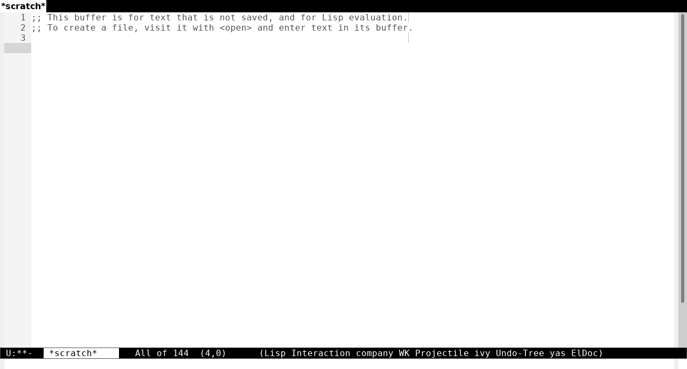

Tools for working with CPF and CNPJ numbers.

### Features
- Generate CPF/CNPJ (optionally formatted);
- Format region as CPF/CNPJ;
- Insert generated CPF/CNPJ.



## Installation

### Using `package-install-file`

<kbd>M</kbd><kbd>x</kbd> `package-install-file cpf-tools.el`

### Load path

Or just place `cpf-tools.el` file in the `load-path` directory and `(require 'cpf-tools)`.

### With use-package

```elisp
(use-package cpf-tools
  :ensure t
  :vc (:url "https://github.com/jjnilton/cpf-tools" :rev :newest))
```

## Usage

To generate valid CPF and CNPJ:

- `(cpf-tools/generate-cpf)` => "12345678910"
- `(cpf-tools/generate-cnpj)` => "12345678000190"

Note: these functions are interactive and can be used the following prefixes:

- `nil`: outputs the unformatted string to the `*Messages*` buffer;
- <kbd>C</kbd><kbd>u</kbd>: inserts the unformatted generated CPF/CNPJ string at point;
- <kbd>C</kbd><kbd>u</kbd> <kbd>C</kbd><kbd>u</kbd>: outputs the generated and formatted CPF/CNPJ to the `*Messages*` buffer;
- <kbd>C</kbd><kbd>u</kbd> <kbd>C</kbd><kbd>u</kbd> <kbd>C</kbd><kbd>u</kbd>: inserts and formats the generated CPF/CNPJ string at point.

To format CPF and CNPJ:

- `(cpf-tools/format-cpf-region (point-min) (point-max))`  => "123.456.789-10"
- `(cpf-tools/format-cnpj-region (point-min) (point-max))` => "12.345.678/0001-90"
- `(cpf-tools/format-cpf-cnpj-region (point-min) (point-max))` => "123.456.789-10" or "12.345.678/0001-90"
